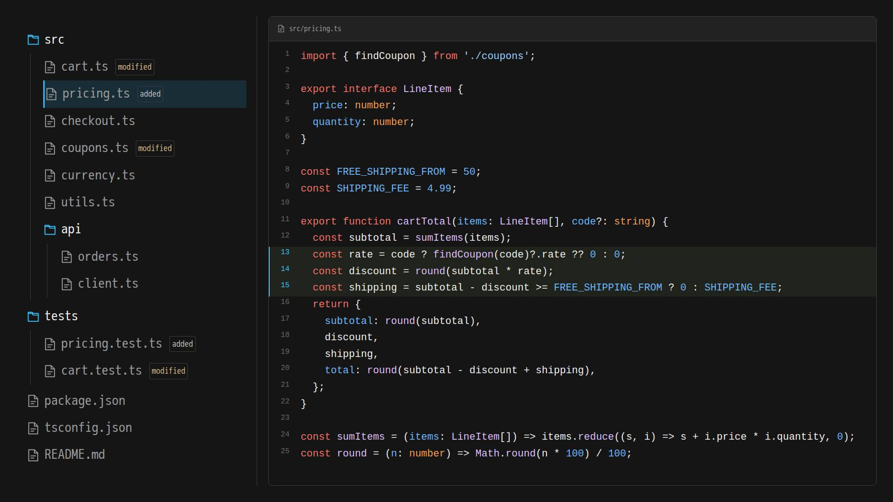
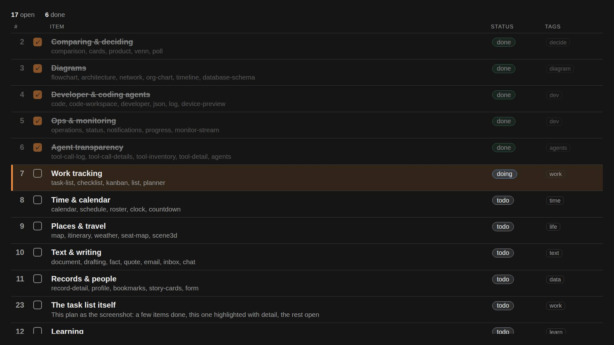
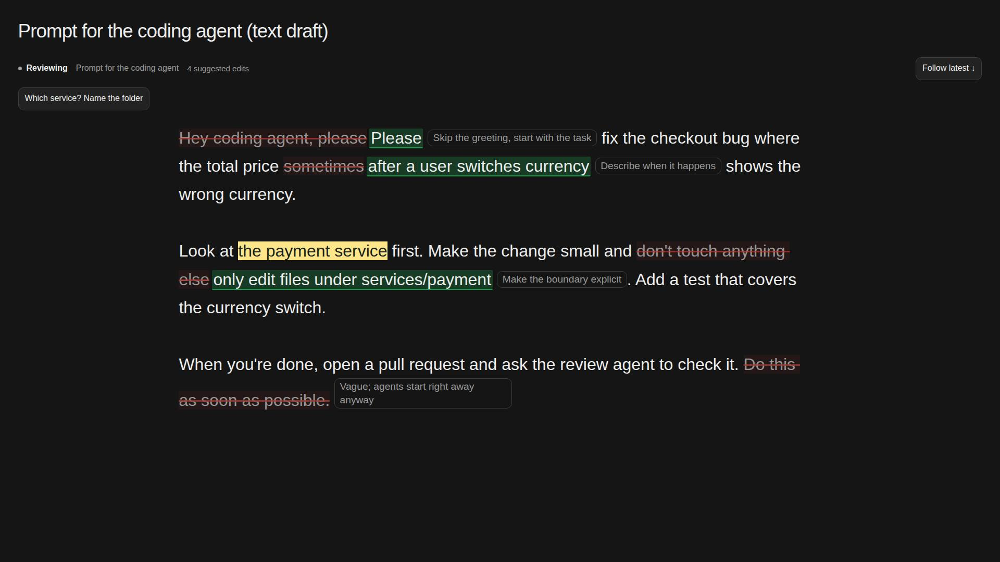
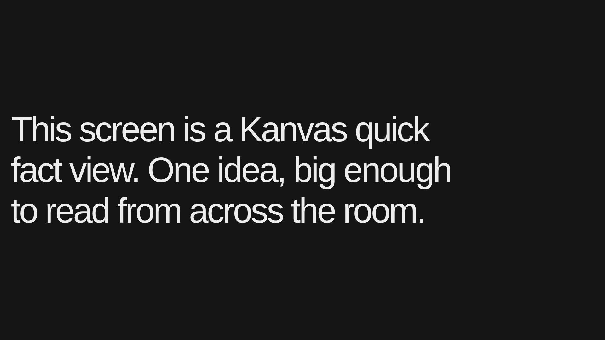

# Kanvas

Kanvas is your agent's screen: a visual surface for you and your AI agents, in any browser, at any size. There is no intelligence inside Kanvas; the agent decides what to show, and Kanvas renders it and reports back.

You talk or type to your agent, and the relevant thing appears on the screen: a chart, a checklist, a map, a code snippet, a plan, an email draft, a calendar. You react, it changes. The goal is the shortest time to clarity, like working through a problem with a colleague at a whiteboard.

<table>
<tr><td></td><td></td></tr>
<tr><td></td><td></td></tr>
</table>

[See all screenshots](https://open-kanvas.ai/#gallery)

There is a hosted version of Kanvas that is free to try. Add the connector `https://kanvas.host/mcp` to your agent, open [kanvas.host](https://kanvas.host) in a browser on any screen, and ask your agent to show you something. Setup guides for each agent are at [open-kanvas.ai](https://open-kanvas.ai).

## What is in this repository

The complete Kanvas application: the server, the web client and the agent-facing MCP interface, in one TypeScript package.

- Two MCP tools. Agents use exactly kanvas_discover and kanvas_call. Discovery lists, searches and explains; call executes any operation from a large built-in catalog (publish, patch, navigate, point, share, monitor, checklists, settings...). [Full operation reference](https://kanvas.host/docs/reference).
- Native templates. Charts, tables, code, maps, diagrams, itineraries, checklists, planners, signage, media and more, each with a schema the agent fills in. Templates are what make Kanvas fast: the agent sends data, not markup, so a view appears almost instantly. [Template guides](docs/templates/README.md).
- Custom HTML. For anything the templates do not cover, the agent can publish its own HTML, so Kanvas can show anything you like. It is slower to produce and less uniform, which is why it is the fallback, not the default.
- Multi-screen sessions. A phone, a laptop and a room display can each show a different view of the same session; views are retained and browsable.
- Accounts and access. Email sign-in, device approval, session permissions, sharing and invitations.

Kanvas does not run a language model, fetch your source data or listen to your microphone. Content is preserved as supplied and private unless you choose otherwise.

## How the code is organised

```text
src/server/ — Node server: HTTP app, domain model, PostgreSQL store, auth
src/server/mcp/ — the two tools, operation registry, discovery, guidance
src/client/ — React viewer, workspace and one renderer per template
src/shared/ — template schemas, types and the help catalog used by both
docs/ — architecture, integration, operations, templates
tests/ — unit (vitest), MCP contract and end-to-end (playwright)
```

A template lives in three places: its schema in src/shared/view-schemas.ts, its renderer in src/client/renderers/, and its help entry in src/shared/help.ts. Start there to add or change one.

## Run it

Self-hosting needs Node.js 24+, PostgreSQL 15+ and a public HTTPS origin. Follow [docs/operations/self-hosting.md](docs/operations/self-hosting.md), or hand this repository URL to your agent and ask it to install and verify it.

## Contribute

Kanvas has a deliberate philosophy: a light visual surface with no intelligence inside, native templates first, built for low-latency, live interaction between a person and their agent. Before proposing a feature, read the yardstick in [CONTRIBUTING.md](CONTRIBUTING.md). We want Kanvas to stay lightweight, so we are careful about changes that add intelligence or logic that belongs in the agent. New and better templates are the most welcome kind of contribution.

[CONTRIBUTING.md](CONTRIBUTING.md) covers local development and tests. Documentation map: [docs/README.md](docs/README.md). Security policy: [SECURITY.md](SECURITY.md).

Schemas are always taken from the running instance at /docs/; release identity lives in package.json and /version.json.

## License

Kanvas is licensed under the Apache License, Version 2.0. See [LICENSE](LICENSE). Third-party code, data and assets retain their own terms; see [NOTICE](NOTICE) and the [complete licence index and unresolved rights](docs/licenses/README.md). "Kanvas" and the Kanvas logo are trademarks of the project and are not covered by the license.
